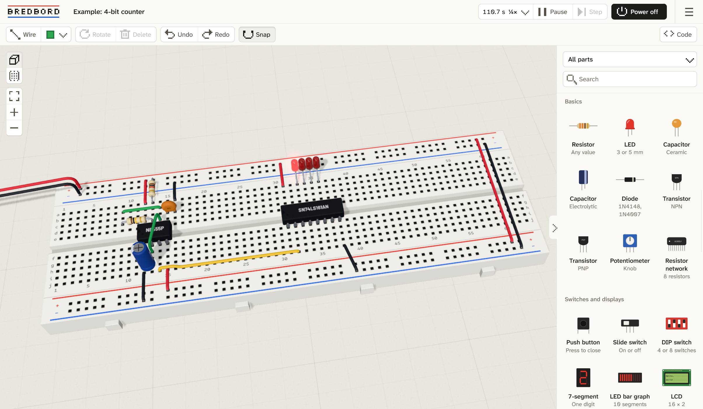

# Bredbord

A free 3D breadboard simulator that runs in the browser.

**Try it:** [bredbord](https://bredbord.vercel.app/)



Ben Eater's breadboard computer [videos](https://www.youtube.com/playlist?list=PLowKtXNTBypGqImE405J2565dvjafglHU) were a huge inspiration for this. Most of the chips from his 8-bit and 6502 builds are here. There are probably some issues so beware. Full builds might still be laggy, trying to improve performance. Mobile support is in development.

## Parts

- Breadboards, power rails, a power module (5 V / 3.3 V)
- Resistors, capacitors, LEDs, diodes, transistors, potentiometers
- Push buttons, slide switches, DIP switches, 7-segment displays, LED bar graph, 16×2 LCD
- 74LS00, 02, 04, 08, 10, 11, 14, 27, 32, 47, 74, 76, 86, 107, 125, 138, 139, 157, 161, 173, 189, 193, 245, 273, 283, 74HC595, NE555
- 28C16 and AT28C256 EEPROMs, 62256 RAM, W65C02S CPU
- Arduino Nano (runs ATmega328P `.hex` files)

## Accuracy

Checked against ngspice: a 555's period comes out within 2 %, and a 2N3904 switch's base and collector currents within 2 % and 6 %. Transistors are modelled for switching, so amplifiers won't be accurate. The 6502 passes Klaus Dormann's functional tests.

## Running it locally

Needs Node 22 or later.

```bash
npm install
npm run dev
```

`npm test` runs the tests, `npm run typecheck` checks types, `npm run format` formats the code. [ARCHITECTURE.md](ARCHITECTURE.md) explains how the code is laid out.

## Contributing

Issues and pull requests are welcome!

## License

MIT. Third-party libraries and fonts are listed in [THIRD_PARTY_NOTICES.md](THIRD_PARTY_NOTICES.md).
